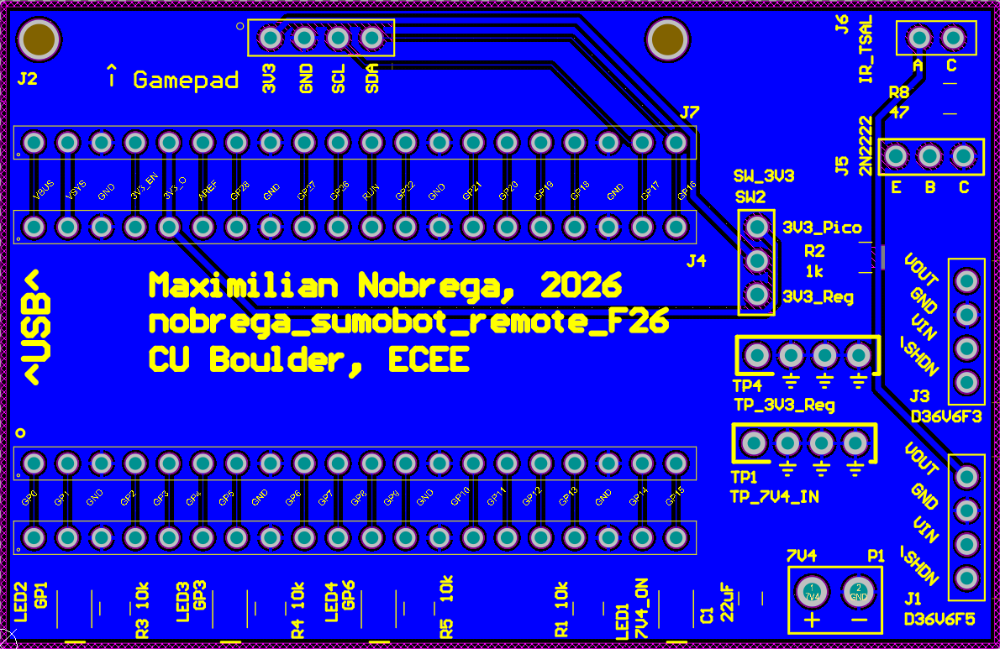
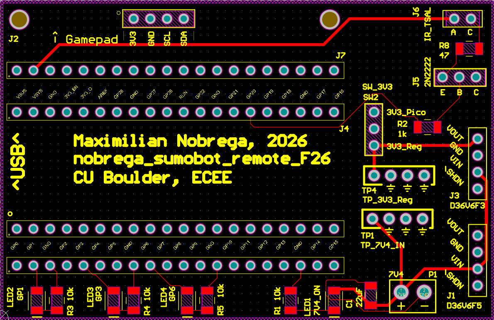
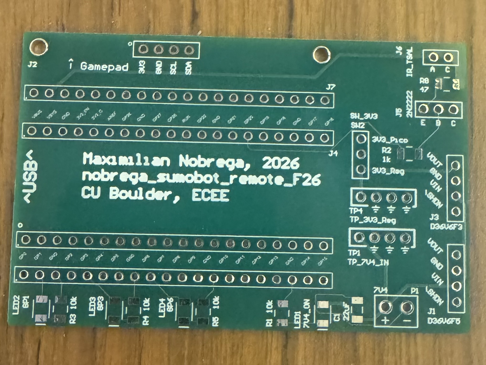
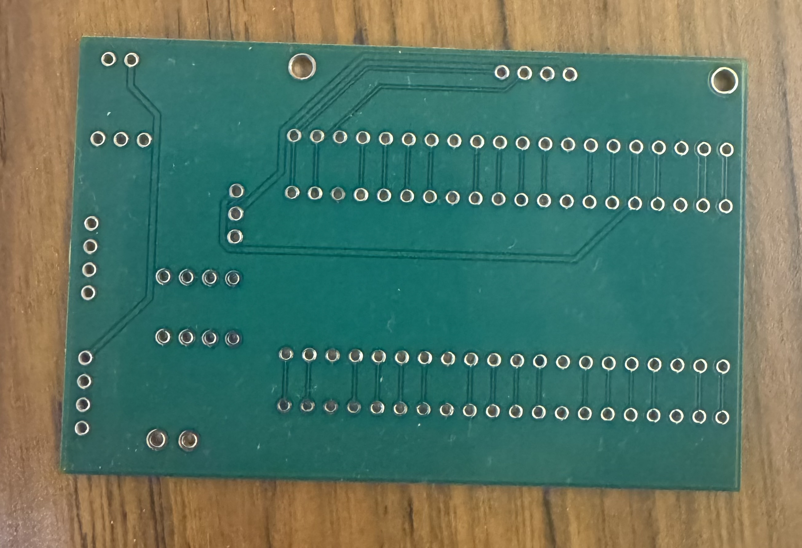

# SumoBot Remote Controller

**PCB Layout Design | Hardware Assembly | Electrical Testing**

## Project Overview

This project involved the development of a custom printed circuit board (PCB) for a SumoBot remote controller. The controller uses a Raspberry Pi Pico microcontroller, an Adafruit Gamepad QT, and infrared (IR) transmission circuitry.

Working from a provided circuit schematic, I independently designed the complete two-layer PCB layout using Altium Designer. I then prepared the design for manufacturing, coordinated PCB fabrication through JLCPCB, and personally soldered and assembled the finished hardware.

The completed PCB was successfully assembled and tested.

## My Contributions

### PCB Layout Design

- Independently designed the complete two-layer PCB layout in Altium Designer using a provided schematic.
- Performed component placement and trace routing for the microcontroller, gamepad interface, power circuitry, and IR transmitter.
- Implemented ground copper pours.
- Ran multiple design rule checks (DRCs), identifying and resolving clearance violations.
- Verified manufacturing compatibility using JLCPCB's design checks.

### Manufacturing and Assembly

- Generated Gerber and drill files for PCB fabrication.
- Coordinated manufacturing through JLCPCB.
- Personally soldered and assembled the PCB components.
- Verified successful operation of the completed hardware.

### Hardware Testing

- Tested voltage regulation and power circuitry using laboratory equipment.
- Verified infrared transmitter and receiver functionality.
- Demonstrated infrared reception at distances up to 8.23 meters.

## Hardware Components

| Component | Function |
|---|---|
| Raspberry Pi Pico | Main microcontroller |
| Adafruit Gamepad QT | User input interface |
| TSAL6400 IR LED | Infrared transmission |
| Transistor driver circuitry | IR LED switching |
| Voltage regulation circuitry | Power conditioning |

## Software and Equipment

**PCB Design:** Altium Designer

**Testing Equipment:** Oscilloscope, digital multimeter, benchtop DC power supply

## PCB Design

The PCB was designed with two copper layers and ground pours. The layout was iteratively refined to resolve design-rule violations and satisfy manufacturing requirements.

### PCB Layout Screenshots

**Bottom Copper Layer — Routing and Ground Pour**

**Top Copper Layer — Component Placement and Routing**

## Manufacturing

The completed PCB design was submitted to JLCPCB for fabrication using the generated Gerber and drill files.

[View PCB Manufacturing Files](Project_Outputs_Nobrega_SumoBot.zip)

The ZIP archive contains the Gerber and drill files used to manufacture the two-layer PCB.

## Manufactured PCB

The custom two-layer PCB was fabricated through JLCPCB using Gerber and drill files generated in Altium Designer. The manufactured board demonstrates the transition from the digital PCB layout to a physical circuit board.

The photographs below show both sides of the fabricated PCB, including component footprints, silkscreen labeling, plated through-holes, and routed copper traces.

### Top Side — Component Placement and Silkscreen

*Top side of the manufactured PCB showing component footprints, silkscreen labels, and through-hole connections.*

### Bottom Side — Copper Routing

*Bottom side of the manufactured PCB showing routed copper traces and through-hole connections beneath the solder mask.*

## Results

- Successfully completed and manufactured the custom two-layer PCB.
- Resolved PCB clearance violations through iterative design-rule verification.
- Soldered and assembled the physical controller hardware.
- Verified successful operation of the assembled PCB.
- Demonstrated infrared reception at distances up to 8.23 meters.

## Project Attribution

The original circuit schematic was provided as part of the project. My individual contributions included PCB layout design, design-rule verification, manufacturing preparation, soldering, assembly, and hardware testing.
